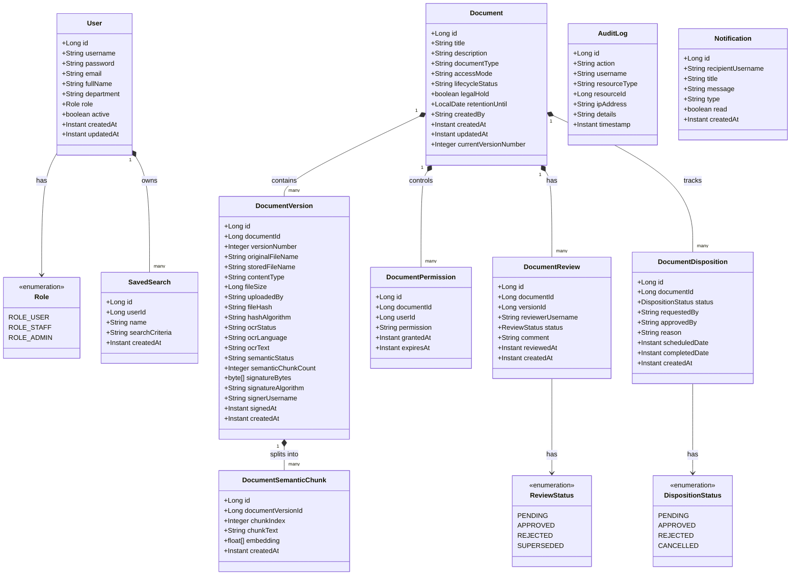

# TÀI LIỆU THIẾT KẾ & BÀN GIAO MÔ HÌNH UML CHO STARUML
## Dự Án: Hệ Thống Quản Lý Và Lưu Trữ Tài Liệu Điện Tử Doanh Nghiệp (EDMS)
### Người phụ trách phân tích & thiết kế: Viên Bảo Đức (System Analyst & Designer)
### Môn học: Công nghệ phần mềm nâng cao — HUFLIT
### Căn cứ kỹ thuật: Mã nguồn Backend Spring Boot & Frontend React (PR #15, commit `43bea99`)

---

## 1. MỤC ĐÍCH VÀ NGUYÊN TẮC THIẾT KẾ

Tài liệu này đóng vai trò bản đặc tả thiết kế kỹ thuật (Design Specification & UML Blueprint) để thành viên phụ trách UML (**Viên Bảo Đức**) sử dụng phần mềm **StarUML** vẽ lại toàn bộ các sơ đồ hệ thống cho bản báo cáo đồ án tốt nghiệp / đồ án môn học tại HUFLIT.

### Nguyên tắc bắt buộc (Traceability & Truthfulness):
1. **Tuyệt đối không bịa đặt:** Chỉ sử dụng các Actor, API, Entity, Enum và nghiệp vụ thực sự tồn tại trong mã nguồn.
2. **Khớp 3 vai trò:** Hệ thống chỉ gồm **3 Actor có tài khoản** (`ROLE_ADMIN`, `ROLE_STAFF`, `ROLE_USER`) và **1 Actor công khai** (`Public User`), không đưa vào `ROLE_MANAGER` hay `ROLE_AUDITOR`.
3. **Khớp 4 trạng thái xét duyệt:** `PENDING`, `APPROVED`, `REJECTED`, `SUPERSEDED` (theo enum `ReviewStatus.java`).
4. **Khớp 4 trạng thái tiêu hủy:** `PENDING`, `APPROVED`, `REJECTED`, `CANCELLED` (theo enum `DispositionStatus.java`).
5. **Khớp 10 bảng cơ sở dữ liệu:** Khóa chính, khóa ngoại và quan hệ dữ liệu khớp 100% với PostgreSQL `edms_db`.

---

## 2. DANH MỤC ACTOR HỆ THỐNG (HỆ THỐNG THỰC TẾ)

| Ký hiệu Actor | Tên Actor | Định nghĩa & Phạm vi Quyền hạn | File Mã Nguồn Đối Chiếu |
| :--- | :--- | :--- | :--- |
| **`Admin`** | Quản trị viên hệ thống (`ROLE_ADMIN`) | Toàn quyền quản trị hệ thống: Quản lý người dùng, xem KPI Dashboard, phê duyệt xét duyệt, phê duyệt tiêu hủy, xem nhật ký kiểm toán, cấu hình hệ thống. | `Role.java`, `SecurityConfig.java`, `UsersPage.tsx` |
| **`Staff`** | Chuyên viên nghiệp vụ (`ROLE_STAFF`) | Người dùng tác nghiệp chính: Tải lên tài liệu, tạo phiên bản mới, gửi yêu cầu xét duyệt, ký số điện tử trên tài liệu được phân công, chia sẻ tài liệu. | `Role.java`, `DocumentsPage.tsx`, `UploadModal.tsx` |
| **`User`** | Người dùng cơ bản (`ROLE_USER`) | Tra cứu tài liệu công khai / nội bộ được chia sẻ, xem trước trực tuyến, tải xuống tệp nhị phân, lưu bộ lọc tìm kiếm cá nhân. | `Role.java`, `DocumentsPage.tsx` |
| **`PublicGuest`** | Khách vãng lai / Đối tác | Truy cập cổng tra cứu công khai `/verify` không cần đăng nhập để tải tệp hoặc kiểm tra mã băm xác thực chữ ký số X.509. | `PublicVerifyController.java`, `PublicVerifyPage.tsx` |
| **`SystemEngine`** | Hệ thống tiến trình nền | Thực thi các tác vụ nền tự động: Trích xuất OCR (Tesseract), Vector hóa ngữ nghĩa AI (ONNX Runtime), Quét tài liệu hết hạn lưu trữ (Scheduled Job). | `TesseractOcrService.java`, `OnnxEmbeddingService.java`, `DispositionJob.java` |

---

## 3. THIẾT KẾ SƠ ĐỒ USE CASE (USE CASE DIAGRAMS)

### 3.1. Sơ đồ Use Case Tổng Quát Hệ Thống (Package Architecture)
Hệ thống được tổ chức thành 6 gói Use Case chính:
1. **`Auth & User Management Package`**
2. **`Document & Version Repository Package`**
3. **`Document Access Control (ACL) Package`**
4. **`Search & Semantic AI Package`**
5. **`Review & Disposition Workflow Package`**
6. **`Digital Signature & Public Verification Package`**

### 3.2. Bảng Danh Mục Use Case Chi Tiết Cho Từng Package

#### Package 1: Auth & User Management
| Use Case ID | Tên Use Case | Primary Actor | Secondary Actor | Pre-condition | Post-condition | API Liên quan |
| :--- | :--- | :--- | :--- | :--- | :--- | :--- |
| **UC-01** | Đăng nhập hệ thống | `User`, `Staff`, `Admin` | — | Tài khoản tồn tại và trạng thái Active | Nhận Access Token (JWT) & Refresh Token | `POST /api/auth/login` |
| **UC-02** | Đăng xuất | `User`, `Staff`, `Admin` | — | Đã đăng nhập | Token được đưa vào danh sách đen | `POST /api/auth/logout` |
| **UC-03** | Quản lý người dùng | `Admin` | — | Đăng nhập với quyền `ROLE_ADMIN` | Danh sách người dùng được cập nhật | `GET /api/users`, `POST /api/users` |
| **UC-04** | Thay đổi vai trò người dùng | `Admin` | — | Đăng nhập với quyền `ROLE_ADMIN` | Vai trò đổi giữa ADMIN, STAFF, USER | `PUT /api/users/{id}/role` |
| **UC-05** | Khóa/Mở tài khoản | `Admin` | — | Đăng nhập với quyền `ROLE_ADMIN` | Trạng thái tài khoản đổi Active/Locked | `PUT /api/users/{id}/status` |

#### Package 2: Document & Version Repository
| Use Case ID | Tên Use Case | Primary Actor | Secondary Actor | Pre-condition | Post-condition | API Liên quan |
| :--- | :--- | :--- | :--- | :--- | :--- | :--- |
| **UC-06** | Xem danh sách tài liệu | `User`, `Staff`, `Admin` | — | Đã xác thực | Trả về danh sách tài liệu có quyền xem | `GET /api/documents` |
| **UC-07** | Tải lên tài liệu mới | `Staff`, `Admin` | `SystemEngine` | Đã xác thực, tệp <= 20MB | Tài liệu V1.0 được lưu, kích hoạt OCR/AI | `POST /api/documents` |
| **UC-08** | Cập nhật siêu dữ liệu | Tác giả, `Admin` | — | Có quyền WRITE trên tài liệu | Siêu dữ liệu tài liệu được cập nhật | `PUT /api/documents/{id}` |
| **UC-09** | Tải lên phiên bản mới | `Staff`, `Admin` | `SystemEngine` | Có quyền WRITE, chọn tệp mới | Tạo version mới (V1.1/V2.0), lưu hash | `POST /api/documents/{id}/versions` |
| **UC-10** | Tải xuống tệp tài liệu | `User`, `Staff`, `Admin` | — | Có quyền READ trên tài liệu | Tải tệp nhị phân về máy client | `GET /api/documents/{id}/download` |
| **UC-11** | Xem lịch sử phiên bản | `User`, `Staff`, `Admin` | — | Có quyền READ trên tài liệu | Danh sách các version và hash SHA-256 | `GET /api/documents/{id}/versions` |
| **UC-12** | Khôi phục phiên bản cũ | `Admin` | — | Đăng nhập quyền `ROLE_ADMIN` | Phiên bản cũ thành phiên bản hiện tại | `POST /api/documents/{id}/versions/{vId}/revert` |

#### Package 3: Document Access Control (ACL)
| Use Case ID | Tên Use Case | Primary Actor | Secondary Actor | Pre-condition | Post-condition | API Liên quan |
| :--- | :--- | :--- | :--- | :--- | :--- | :--- |
| **UC-13** | Xem quyền truy cập | Tác giả, `Admin` | — | Là chủ sở hữu hoặc `ROLE_ADMIN` | Bảng danh sách phân quyền chi tiết | `GET /api/documents/{id}/permissions` |
| **UC-14** | Cấp quyền người dùng | Tác giả, `Admin` | — | Là chủ sở hữu hoặc `ROLE_ADMIN` | Thêm bản ghi phân quyền người dùng | `POST /api/documents/{id}/permissions` |
| **UC-15** | Thu hồi quyền truy cập | Tác giả, `Admin` | — | Là chủ sở hữu hoặc `ROLE_ADMIN` | Bản ghi phân quyền bị xóa | `DELETE /api/documents/{id}/permissions/{pId}` |

#### Package 4: Search & Semantic AI
| Use Case ID | Tên Use Case | Primary Actor | Secondary Actor | Pre-condition | Post-condition | API Liên quan |
| :--- | :--- | :--- | :--- | :--- | :--- | :--- |
| **UC-16** | Tìm kiếm từ khóa | `User`, `Staff`, `Admin` | — | Đã xác thực | Danh sách tài liệu khớp tiêu đề/nội dung | `GET /api/search/documents?q=` |
| **UC-17** | Tìm kiếm ngữ nghĩa AI | `User`, `Staff`, `Admin` | `SystemEngine` | Mô hình ONNX AVAILABLE | Danh sách đoạn văn khớp vector Cosine | `GET /api/search/semantic?query=` |
| **UC-18** | Lưu bộ lọc tìm kiếm | `User`, `Staff`, `Admin` | — | Đã xác thực | Bộ lọc được lưu vào cơ sở dữ liệu | `POST /api/users/saved-searches` |

#### Package 5: Review & Disposition Workflow
| Use Case ID | Tên Use Case | Primary Actor | Secondary Actor | Pre-condition | Post-condition | API Liên quan |
| :--- | :--- | :--- | :--- | :--- | :--- | :--- |
| **UC-19** | Gửi yêu cầu xét duyệt | `Staff` | — | Tài liệu ở trạng thái DRAFT/ACTIVE | Tạo bản ghi Review trạng thái PENDING | `POST /api/reviews` |
| **UC-20** | Phê duyệt xét duyệt | `Admin` | — | Quyền `ROLE_ADMIN`, review PENDING | Review sang APPROVED, tài liệu sang APPROVED | `POST /api/reviews/{id}/approve` |
| **UC-21** | Từ chối xét duyệt | `Admin` | — | Quyền `ROLE_ADMIN`, nhập lý do | Review sang REJECTED, tài liệu về DRAFT | `POST /api/reviews/{id}/reject` |
| **UC-22** | Thay thế xét duyệt | `SystemEngine` | — | Có version mới khi review đang PENDING | Review cũ chuyển trạng thái SUPERSEDED | Triggered khi tạo version mới |
| **UC-23** | Xem hàng đợi tiêu hủy | `Admin` | — | Quyền `ROLE_ADMIN` | Danh sách tài liệu quá hạn retention | `GET /api/dispositions` |
| **UC-24** | Phê duyệt tiêu hủy | `Admin` | — | Quyền `ROLE_ADMIN`, disposition PENDING | Trạng thái sang APPROVED, xóa vật lý tệp | `POST /api/dispositions/{id}/approve` |
| **UC-25** | Hủy bỏ tiêu hủy | `Admin` | — | Quyền `ROLE_ADMIN` | Trạng thái sang CANCELLED, giữ lại tài liệu | `POST /api/dispositions/{id}/cancel` |

#### Package 6: Digital Signature & Public Verification
| Use Case ID | Tên Use Case | Primary Actor | Secondary Actor | Pre-condition | Post-condition | API Liên quan |
| :--- | :--- | :--- | :--- | :--- | :--- | :--- |
| **UC-26** | Ký số tài liệu | `Staff`, `Admin` | — | Tài liệu APPROVED, KeyStore sẵn sàng | Tạo chữ ký SHA256withRSA lưu vào DB | `POST /api/documents/{id}/sign` |
| **UC-27** | Xem trước trực tuyến | `User`, `Staff`, `Admin` | — | Có quyền READ trên tài liệu | Hiển thị PDF Canvas / Image Preview | `GET /api/documents/{id}/preview` |
| **UC-28** | Xác minh chữ ký nội bộ | `User`, `Staff`, `Admin` | — | Tài liệu đã ký số | Hiển thị thông tin chứng chỉ và tính toàn vẹn | `GET /api/documents/{id}/verify-signature` |
| **UC-29** | Tra cứu chữ ký công khai | `PublicGuest` | — | Không cần đăng nhập (`/verify`) | Trả về kết quả xác thực hợp lệ/không hợp lệ | `POST /api/public/verify-document` |

---

## 4. THIẾT KẾ SƠ ĐỒ HOẠT ĐỘNG (ACTIVITY DIAGRAMS)

### 4.1. Sơ đồ Hoạt Động: Tải Lên Tài Liệu & Xử Lý Bất Đồng Bộ (Upload & Indexing)
- **Start Node:** Chuyên viên (`Staff`) nhấn nút "Tải tài liệu mới" trên `DocumentsPage`.
- **Action 1:** Hệ thống mở `UploadModal`.
- **Action 2:** Chuyên viên chọn tệp (.pdf, .docx, .png, .jpg) và nhập Title, Document Type, Access Mode.
- **Decision 1 (Client Validation):**
  - *Branch False (Dung lượng > 20MB hoặc tệp rỗng):* Hiển thị thông báo lỗi, yêu cầu chọn lại.
  - *Branch True (Hợp lệ):* Gửi `MultipartRequest` đến `POST /api/documents`.
- **Action 3:** `DocumentController` tiếp nhận request, xác thực JWT Token.
- **Action 4:** `FileStorageService` lưu tệp vật lý vào `/app/storage/uploads/` và tính mã băm SHA-256.
- **Action 5:** `DocumentService` lưu bản ghi `documents` (với `lifecycle_status = 'ACTIVE'`) và `document_versions` (với `version_number = 1`).
- **Fork Node (Xử lý bất đồng bộ):**
  - **Nhánh A (OCR Engine):**
    - Kiểm tra loại tệp: nếu là PDF hoặc hình ảnh -> Kích hoạt Tesseract OCR tiếng Việt + tiếng Anh.
    - Trích xuất văn bản -> Cập nhật `ocr_text` và đổi `ocr_status = 'READY'`.
  - **Nhánh B (Semantic AI Engine):**
    - Chia văn bản thành các đoạn (chunks 512 tokens).
    - Gọi mô hình ONNX `multilingual-e5-small-onnx-int8-v1` -> Sinh vector 384 chiều.
    - Lưu vào bảng `document_semantic_chunks` và đổi `semantic_status = 'READY'`.
  - **Nhánh C (Audit Logging):**
    - Ghi nhận bản ghi kiểm toán vào bảng `audit_logs` (Action: `DOCUMENT_CREATE`).
- **Join Node:** Hoàn tất lưu trữ và lập chỉ mục.
- **Action 6:** Gửi WebSocket Notification báo tải lên thành công.
- **End Node:** `DocumentsPage` cập nhật hiển thị tài liệu mới trong bảng.

### 4.2. Sơ đồ Hoạt Động: Vòng Đời Xét Duyệt Tài Liệu (Review Workflow)
- **Start Node:** Chuyên viên nhấn "Gửi xét duyệt" trên hồ sơ tài liệu.
- **Action 1:** Nhập ghi chú thẩm định, gửi request `POST /api/reviews`.
- **Action 2:** Hệ thống tạo bản ghi `document_reviews` với `status = 'PENDING'`.
- **Action 3:** Quản trị viên (`Admin`) truy cập `ReviewQueuePage`.
- **Decision 1 (Admin Thẩm định):**
  - **Trường hợp 1 (Phê duyệt - Approve):**
    - Admin nhấn "Phê duyệt" -> `POST /api/reviews/{id}/approve`.
    - Hệ thống chuyển `document_reviews.status = 'APPROVED'`.
    - Cập nhật `documents.lifecycle_status = 'APPROVED'`.
    - Ghi nhận `audit_logs` và gửi thông báo chúc mừng đến tác giả.
  - **Trường hợp 2 (Từ chối - Reject):**
    - Admin nhập lý do từ chối -> `POST /api/reviews/{id}/reject`.
    - Hệ thống chuyển `document_reviews.status = 'REJECTED'`.
    - Cập nhật `documents.lifecycle_status = 'DRAFT'`.
    - Gửi thông báo yêu cầu sửa đổi đến tác giả.
  - **Trường hợp 3 (Thay thế - Superseded):**
    - Khi yêu cầu đang `PENDING`, tác giả tải lên phiên bản mới V1.1 -> Hệ thống tự động chuyển yêu cầu xét duyệt cũ thành `status = 'SUPERSEDED'`.
    - Tạo yêu cầu xét duyệt mới cho phiên bản V1.1.
- **End Node:** Kết thúc quy trình xét duyệt.

### 4.3. Sơ đồ Hoạt Động: Quản Lý Tiêu Hủy Tài Liệu (Disposition Lifecycle)
- **Start Node:** Định kỳ mỗi ngày, Scheduled Job `DispositionJob` tự động kích hoạt.
- **Action 1:** Quét các tài liệu có `retention_until <= CURRENT_DATE` và `legal_hold = false`.
- **Action 2:** Tự động tạo bản ghi `document_dispositions` với `status = 'PENDING'`.
- **Action 3:** Admin truy cập `DispositionQueuePage`.
- **Decision 1 (Quyết định xử lý hồ sơ quá hạn):**
  - **Trường hợp 1 (Phê duyệt tiêu hủy):**
    - Admin nhấn "Tiêu hủy" -> `POST /api/dispositions/{id}/approve`.
    - Chuyển `disposition.status = 'APPROVED'`, `documents.lifecycle_status = 'DESTROYED'`.
    - Xóa các tệp nhị phân trong `/app/storage/uploads/`.
    - Tạo chứng nhận tiêu hủy bất biến trong `audit_logs`.
  - **Trường hợp 2 (Hủy bỏ tiêu hủy - Cancel):**
    - Admin quyết định tiếp tục lưu trữ tài liệu nghiệp vụ -> Nhấn "Hủy bỏ" (`CANCELLED`).
    - Chuyển `disposition.status = 'CANCELLED'`.
    - Gia hạn ngày `retention_until` mới.
  - **Trường hợp 3 (Từ chối tiêu hủy - Reject):**
    - Admin từ chối yêu cầu tiêu hủy -> Chuyển `disposition.status = 'REJECTED'`.
- **End Node:** Hoàn tất chu trình kiểm soát vòng đời tài liệu.

---

## 5. THIẾT KẾ SƠ ĐỒ TRÌNH TỰ (SEQUENCE DIAGRAMS)

### 5.1. Sequence Diagram 1: Xác thực Đăng nhập & Cấp phát JWT Token
- **Actors & Objects:**
  - `User`: Actor
  - `LoginPage`: React UI
  - `AuthController`: Spring Boot REST Controller
  - `AuthService`: Service tầng nghiệp vụ
  - `AuthenticationManager`: Spring Security Engine
  - `JwtTokenProvider`: Thành phần sinh mã JWT
  - `UserRepository`: Tầng truy xuất dữ liệu
  - `Database`: PostgreSQL (`users`)
- **Luồng thông điệp:**
  1. `User -> LoginPage`: Nhập username, password -> Nhấn "Đăng nhập"
  2. `LoginPage -> AuthController`: `POST /api/auth/login { username, password }`
  3. `AuthController -> AuthService`: `login(loginRequest)`
  4. `AuthService -> AuthenticationManager`: `authenticate(new UsernamePasswordAuthenticationToken(user, pass))`
  5. `AuthenticationManager -> UserRepository`: `findByUsername(username)`
  6. `UserRepository -> Database`: `SELECT * FROM users WHERE username = ?`
  7. `Database --> UserRepository`: Trả về `UserEntity` (mật khẩu băm BCrypt, vai trò `ROLE_STAFF`)
  8. `AuthenticationManager`: So khớp mật khẩu với BCrypt `matches()`
     - *Alt [Mật khẩu sai hoặc tài khoản bị khóa]:*
       - `AuthenticationManager --> AuthService`: Quăng ngoại lệ `BadCredentialsException`
       - `AuthService --> AuthController`: Trả về HTTP 401 Unauthorized
       - `AuthController --> LoginPage`: Hiển thị thông báo "Tên đăng nhập hoặc mật khẩu không chính xác"
     - *Alt [Xác thực thành công]:*
       - `AuthenticationManager --> AuthService`: Trả về đối tượng `Authentication`
       - `AuthService -> JwtTokenProvider`: `generateAccessToken(user)`, `generateRefreshToken(user)`
       - `JwtTokenProvider --> AuthService`: Trả về JWT Access Token (hạn 15 phút) & Refresh Token (hạn 7 ngày)
       - `AuthService --> AuthController`: Trả về `JwtAuthResponseDto`
       - `AuthController --> LoginPage`: HTTP 200 OK `{ accessToken, refreshToken, role: 'ROLE_STAFF' }`
       - `LoginPage`: Lưu token vào LocalStorage/Memory, điều hướng sang `DocumentsPage`.

### 5.2. Sequence Diagram 2: Tìm kiếm Ngữ nghĩa AI (Semantic Vector Search)
- **Actors & Objects:**
  - `Staff / User`: Actor
  - `DocumentsPage`: React UI
  - `SemanticSearchController`: Controller tiếp nhận truy vấn
  - `OnnxEmbeddingService`: Engine AI nhúng cục bộ
  - `SemanticChunkRepository`: Tầng truy vấn vector database
  - `Database`: PostgreSQL (`document_semantic_chunks`, `documents`)
- **Luồng thông điệp:**
  1. `User -> DocumentsPage`: Chọn chế độ "Ngữ nghĩa AI" -> Nhập câu hỏi nghiệp vụ -> Nhấn "Tìm kiếm"
  2. `DocumentsPage -> SemanticSearchController`: `GET /api/search/semantic?query={câu hỏi}&threshold=0.7`
  3. `SemanticSearchController -> OnnxEmbeddingService`: `embedQuery(queryText)`
  4. `OnnxEmbeddingService`: Tokenize câu hỏi -> Đưa qua mô hình ONNX `multilingual-e5-small-onnx-int8-v1`
  5. `OnnxEmbeddingService --> SemanticSearchController`: Trả về vector float[384]
  6. `SemanticSearchController -> SemanticChunkRepository`: `findTopSimilarChunks(vector, threshold, limit)`
  7. `SemanticChunkRepository -> Database`: Tính khoảng cách Cosine `cosine_similarity(chunk_vector, query_vector)`
  8. `Database --> SemanticChunkRepository`: Trả về các đoạn văn bản có điểm Cosine cao nhất (ví dụ score: `0.8510`)
  9. `SemanticChunkRepository --> SemanticSearchController`: Danh sách `DocumentSemanticChunk` kèm `Document`
  10. `SemanticSearchController --> DocumentsPage`: HTTP 200 OK `[{ docId, title, chunkText, similarityScore: 0.8510, semanticMatched: true }]`
  11. `DocumentsPage`: Hiển thị danh sách kết quả kèm huy hiệu điểm tương đồng Modern Aurora.

### 5.3. Sequence Diagram 3: Ký số Điện tử & Xác thực Chữ ký Công khai
- **Actors & Objects:**
  - `Staff`: Actor thực hiện ký số
  - `PublicGuest`: Khách vãng lai tra cứu
  - `PreviewModal`: React UI nội bộ
  - `PublicVerifyPage`: React UI công khai (`/verify`)
  - `SignatureController`: REST Controller chữ ký nội bộ
  - `PublicVerifyController`: REST Controller công khai
  - `SignatureService`: Nghiệp vụ ký số & băm SHA-256
  - `KeyStoreService`: Dịch vụ quản lý khóa PKCS#12 (`/app/keys/edms-signing.p12`)
  - `Database`: PostgreSQL (`document_versions`)
- **Luồng thông điệp Ký số nội bộ:**
  1. `Staff -> PreviewModal`: Nhấn "Ký số tài liệu"
  2. `PreviewModal -> SignatureController`: `POST /api/documents/{id}/sign`
  3. `SignatureController -> SignatureService`: `signDocument(docId, userPrincipal)`
  4. `SignatureService -> KeyStoreService`: `getPrivateKey()`, `getSigningCertificate()`
  5. `KeyStoreService`: Đọc chứng chỉ X.509 self-signed RSA-2048 từ `/app/keys/edms-signing.p12`
  6. `SignatureService`: Băm tệp bằng SHA-256 -> Mã hóa bằng khóa riêng RSA (`SHA256withRSA`)
  7. `SignatureService -> Database`: Lưu `signature_bytes`, `signature_algorithm`, `signer_username`, `signed_at` vào `document_versions`
  8. `SignatureService --> SignatureController`: Trả về `SignatureResultDto`
  9. `SignatureController --> PreviewModal`: HTTP 200 OK -> Hiển thị huy hiệu "Đã ký số xác thực hợp lệ"
- **Luồng thông điệp Tra cứu Công khai:**
  1. `PublicGuest -> PublicVerifyPage`: Tải tệp văn bản cần kiểm tra lên `/verify` -> Nhấn "Xác thực"
  2. `PublicVerifyPage -> PublicVerifyController`: `POST /api/public/verify-document` (Multipart tệp)
  3. `PublicVerifyController -> SignatureService`: `verifyExternalFile(fileBytes)`
  4. `SignatureService`: Tính mã băm SHA-256 -> Đối soát với `file_hash` và giải mã chữ ký bằng chứng chỉ công khai X.509
  5. `SignatureService --> PublicVerifyController`: Trả về `{ valid: true, signer: 'hieu', signedAt: '...', certSerial: '...' }`
  6. `PublicVerifyController --> PublicVerifyPage`: HTTP 200 OK
  7. `PublicVerifyPage`: Hiển thị thẻ xác thực thành công màu xanh Aurora, thông tin người ký và chứng chỉ tự ký X.509.

---

## 6. THIẾT KẾ SƠ ĐỒ LỚP THỰC THỂ (CLASS DIAGRAM — ENTITY MODEL)

Ánh xạ 1:1 với 10 lớp Entity JPA trong `backend/src/main/java/com/edms/entity/`:

---

## 7. THIẾT KẾ SƠ ĐỒ CƠ SỞ DỮ LIỆU VẬT LÝ (PHYSICAL ERD)

### Bảng Mô Tả Quan Hệ Khóa Chính & Khóa Ngoại (Foreign Keys)
1. **`document_versions.document_id`** -> `documents.id` (`ON DELETE CASCADE`)
2. **`document_permissions.document_id`** -> `documents.id` (`ON DELETE CASCADE`)
3. **`document_permissions.user_id`** -> `users.id` (`ON DELETE CASCADE`)
4. **`document_reviews.document_id`** -> `documents.id`
5. **`document_dispositions.document_id`** -> `documents.id`
6. **`saved_searches.user_id`** -> `users.id` (`ON DELETE CASCADE`)
7. **`document_semantic_chunks.document_version_id`** -> `document_versions.id` (`ON DELETE CASCADE`)

### Khóa Duy Nhất & Chỉ Mục (Indexes & Constraints)
- `users`: UNIQUE (`username`), UNIQUE (`email`).
- `document_versions`: UNIQUE (`document_id`, `version_number`).
- `documents`: PRIMARY KEY (`id`).
- `audit_logs`: INDEX (`username`), INDEX (`timestamp`), INDEX (`action`).

---

## 8. HƯỚNG DẪN THÀNH VIÊN VẼ TRÊN STARUML

1. **Khởi động StarUML:** Tạo Project mới, đặt tên `EDMS_System_Design.mdj`.
2. **Tạo Model:** Chia làm các Package:
   - `Use Case Model`: Dựng Use Case tổng quát và 6 Use Case Package. Sử dụng các Actor `Admin`, `Staff`, `User`, `PublicGuest`.
   - `Dynamic Model`:
     - Vẽ 3 Activity Diagram theo đặc tả luồng và decision nodes tại Mục 4.
     - Vẽ 3 Sequence Diagram theo cấu trúc đối tượng và thông điệp tại Mục 5.
   - `Static Model`:
     - Vẽ Class Diagram thực thể theo 10 Entity và 3 Enum tại Mục 6.
     - Vẽ Physical ERD theo lược đồ quan hệ tại Mục 7.
3. **Xuất sơ đồ (Export Diagrams):** Xuất toàn bộ các diagram ra tệp `.png` độ phân giải cao để chèn vào báo cáo Word đồ án HUFLIT.
